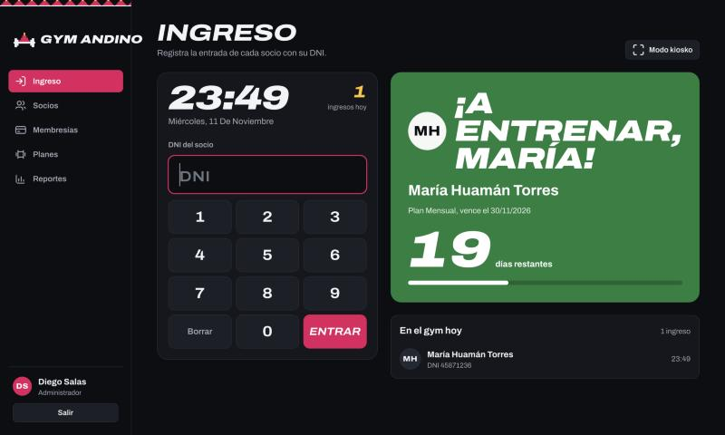
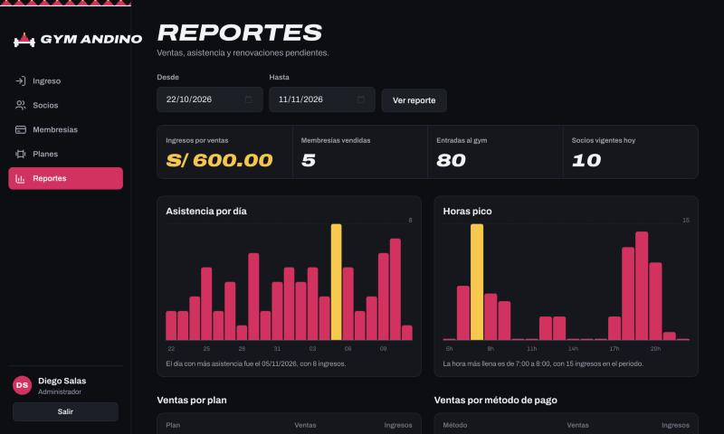
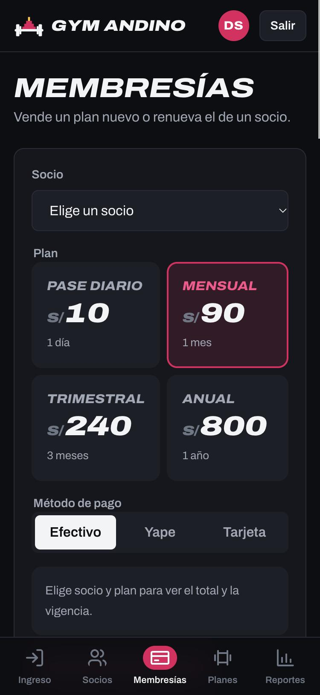

<p align="center">
  
</p>

# Gym Andino

Sistema web para la recepción y administración de un gimnasio: **control de ingreso por DNI**, socios, venta de membresías, planes y reportes de asistencia. Funciona en celular, tablet y computadora, y guarda todo en una base de datos SQLite.

Es el software sobre el que se elabora el **Plan de Pruebas de Software** del curso (plantilla de la semana 04).

## Enlaces

| | |
|---|---|
| **Aplicación en producción** | **<https://gym-andino.onrender.com>** |
| Comprobación de salud | <https://gym-andino.onrender.com/api/salud> |
| Código fuente | <https://github.com/pisarana/gym-andino> (descarga: **Code → Download ZIP**) |
| Pruebas y evidencias | [docs/pruebas](docs/pruebas/README.md): **55 de 55 casos aprobados**, 33 de ellos en producción |
| Reporte E2E en producción | [docs/pruebas/reporte-e2e.md](docs/pruebas/reporte-e2e.md) |
| Hosting | Render, plan gratuito (S/ 0), con despliegue automático en cada commit a `main` |

Los usuarios de prueba están más abajo. La primera visita puede tardar unos segundos, porque el plan gratuito se duerme sin uso.

[](https://dashboard.render.com/blueprint/new?repo=https://github.com/pisarana/gym-andino)

| Recepción (kiosko de ingreso) | Reportes del administrador |
|---|---|
|  |  |

| Inicio de sesión | Venta de membresías en celular |
|---|---|
|  |  |

---

## Qué hace

- **Kiosko de ingreso.** La recepción escribe el DNI (con teclado táctil en tablet). Aparece un pase de acceso grande: verde *"¡A entrenar!"*, amarillo *"Pasa y renueva"* si vence en 7 días o menos, rojo *"Acceso denegado"* si la membresía venció. Muestra los días restantes y la barra de uso del plan, y se reinicia solo para el siguiente socio. Tiene modo pantalla completa.
- **Socios.** Registro, búsqueda por nombre o DNI, edición, ficha con historial de membresías e ingresos, desactivación.
- **Membresías.** Venta y renovación sin cortes: si el socio aún tiene días, el nuevo plan empieza al día siguiente del vencimiento. Pago en efectivo, Yape o tarjeta. El administrador puede anular.
- **Planes.** Pase diario, mensual, trimestral y anual, editables por el administrador.
- **Reportes.** Ingresos por ventas, membresías vendidas, entradas al gym, socios vigentes, asistencia por día, horas pico, ventas por plan y por método, y socios por vencer para llamarlos.
- **Roles.** Administrador y recepción, con permisos distintos.

## Descargar y ejecutar

Requisito: **Node.js 22.13 o superior** ([descargar](https://nodejs.org)). No hay que instalar dependencias.

```bash
git clone https://github.com/pisarana/gym-andino.git
cd gym-andino
npm start
```

Abrir <http://localhost:3000>. También se puede descargar como ZIP desde el botón **Code → Download ZIP** de GitHub.

Para usarlo en el celular, conectarlo a la misma red Wi-Fi que la computadora y abrir `http://IP-DE-LA-PC:3000`.

La base de datos se crea sola en `data/gym.db` con datos de ejemplo. Para empezar de cero, borrar ese archivo y volver a ejecutar.

### Usuarios de prueba

| Usuario | Contraseña | Rol |
|---|---|---|
| `admin` | `Admin2026!` | Administrador |
| `recepcion` | `Recepcion2026!` | Recepción |

### DNIs de ejemplo para probar el ingreso

| DNI | Socio | Resultado esperado |
|---|---|---|
| `45871236` | María Huamán | Puede pasar (membresía vigente) |
| `71234598` | Jorge Ramírez | Pasa y renueva (vence en los próximos días) |
| `40123987` | Lucía Paredes | Acceso denegado (membresía vencida) |
| `46789123` | Ana Flores | Acceso denegado (sin membresía) |
| `99999999` | — | DNI no registrado |

## Pruebas

| Nivel | Casos | Resultado |
|---|---|---|
| Unitarias e integración (`npm test`) | 15 | ✅ 15 de 15 |
| Punta a punta en producción (`npm run e2e`) | 33 | ✅ 33 de 33 |
| Interfaz y responsive en producción (celular y escritorio) | 7 | ✅ 7 de 7 |

El detalle de cada caso, las capturas de evidencia, el registro de los 8 defectos encontrados y corregidos, y las observaciones están en **[docs/pruebas](docs/pruebas/README.md)**.

```bash
npm test      # pruebas unitarias e integración
npm run e2e   # pruebas E2E contra producción (genera docs/pruebas/reporte-e2e.md)
```

Pruebas unitarias e integración (`test/api.test.js`):

| ID | Caso de prueba |
|---|---|
| CP-01 | Login correcto devuelve el usuario y la cookie de sesión |
| CP-02 | Login con contraseña incorrecta devuelve 401 con mensaje genérico |
| CP-03 | La cuenta se bloquea 1 minuto tras 5 intentos fallidos |
| CP-04 | Sin sesión, la API protegida devuelve 401 |
| CP-05 | Recepción no puede ver reportes ni crear planes (403) |
| CP-06 | Validación de DNI, celular y correo del socio |
| CP-07 | No se permite DNI duplicado (409) |
| CP-08 | Fechas de la membresía y renovación encadenada |
| CP-09 | Método de pago inválido devuelve 400 |
| CP-10 | Ingreso con membresía vigente y no se repite el mismo día |
| CP-11 | Ingreso rechazado por membresía vencida, sin membresía o DNI inexistente |
| CP-12 | Anular membresía es solo del administrador y descuenta de los ingresos |
| CP-13 | El reporte valida el rango de fechas |
| CP-14 | Validación y unicidad de planes |
| CP-15 | Archivos estáticos servidos y protección contra salida de directorio |

## Módulos (sistema bajo prueba)

| Módulo | Depende de | Requerimientos principales |
|---|---|---|
| M1. Autenticación y roles | — | Login, cierre de sesión, bloqueo por intentos, permisos por rol |
| M2. Socios | M1 | Registrar, buscar, editar, desactivar y reactivar |
| M3. Planes | M1 | Crear, editar, activar y desactivar (solo administrador) |
| M4. Membresías | M1, M2, M3 | Vender, renovar sin cortes, anular (solo administrador) |
| M5. Ingreso (asistencia) | M1, M2, M4 | Registrar por DNI, solo con membresía vigente y una vez por día |
| M6. Reportes | M1, M4, M5 | Ingresos, ventas, asistencia por día, horas pico, por vencer |

## Reglas de negocio

- DNI: exactamente 8 dígitos y único. Celular opcional: 9 dígitos que empiezan con 9. Correo opcional con formato válido.
- Plan: nombre de 3 a 40 caracteres y único, duración de 1 a 730 días, precio mayor que 0 y hasta S/ 10 000.
- Estado de la membresía: vigente, por vencer (7 días o menos), vencida o sin membresía.
- El ingreso se rechaza si el socio no existe, está inactivo, no tiene membresía vigente o ya ingresó ese día.
- Recepción no puede ver reportes, gestionar planes, anular membresías ni desactivar socios.
- Una membresía anulada deja de contar en los ingresos y no permite el ingreso.

## API

| Método | Ruta | Rol | Descripción |
|---|---|---|---|
| POST | `/api/login` | Público | Inicia sesión |
| POST | `/api/logout` | Sesión | Cierra sesión |
| GET | `/api/me` | Sesión | Usuario actual |
| GET | `/api/salud` | Público | Comprobación de salud |
| GET/POST | `/api/socios` | Sesión | Listar (con `?q=`) y registrar socios |
| GET/PUT | `/api/socios/:id` | Sesión | Ficha y edición del socio |
| DELETE | `/api/socios/:id` | Admin | Desactivar socio |
| GET | `/api/planes` | Sesión | Planes activos (`?todos=1` para admin) |
| POST/PUT/DELETE | `/api/planes[/:id]` | Admin | Gestionar planes |
| GET/POST | `/api/membresias` | Sesión | Últimas ventas y vender membresía |
| POST | `/api/membresias/:id/anular` | Admin | Anular membresía |
| GET/POST | `/api/asistencias` | Sesión | Ingresos del día y registrar ingreso |
| GET | `/api/reportes/resumen` | Admin | Reporte (`?desde=AAAA-MM-DD&hasta=AAAA-MM-DD`) |

## Despliegue en producción (Render)

El repositorio incluye [`render.yaml`](render.yaml) (Blueprint de Render). Con el botón **Deploy to Render** de arriba:

1. Inicia sesión en Render con tu cuenta de GitHub.
2. Revisa el servicio `gym-andino` (plan gratuito) y pulsa **Apply**.
3. Render ejecuta `npm test` (si alguna prueba falla, no se publica) y luego `npm start`.

Importante sobre el plan gratuito: el disco no es persistente. La base vuelve a los datos de ejemplo en cada despliegue o reinicio, y el servicio se duerme tras 15 minutos sin uso (la primera visita tarda unos segundos). Para conservar datos se necesita un disco persistente de pago o una base externa.

## Estructura

```
gym-andino/
├── server.js          Servidor HTTP y API REST
├── db.js              Esquema SQLite y datos de ejemplo
├── public/            Interfaz (HTML, CSS, JavaScript, logo)
├── test/api.test.js   15 pruebas unitarias e integración
├── scripts/e2e.mjs    33 pruebas E2E contra producción
├── docs/pruebas/      Reportes, evidencias y registro de defectos
├── docs/capturas/     Capturas de pantalla
└── render.yaml        Configuración de despliegue
```

## Tecnología y seguridad

- **Backend:** Node.js (`node:http`), API REST JSON, sin dependencias externas.
- **Base de datos:** SQLite integrado en Node (`node:sqlite`) con 5 tablas: `usuarios`, `planes`, `socios`, `membresias`, `asistencias`.
- **Frontend:** HTML, CSS y JavaScript sin frameworks. Diseño mobile-first, tipografía Archivo y logo propio.
- **Seguridad:** contraseñas con scrypt, cookie de sesión `HttpOnly` + `SameSite=Strict` (+ `Secure` en producción), bloqueo por intentos fallidos, consultas SQL parametrizadas, cabeceras CSP, `nosniff` y `X-Frame-Options`, y protección contra salida de directorio.
