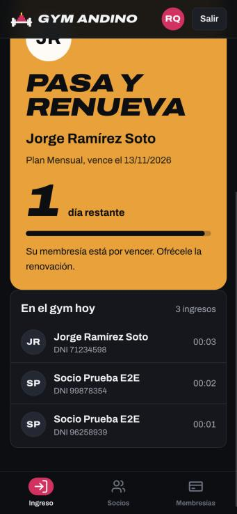
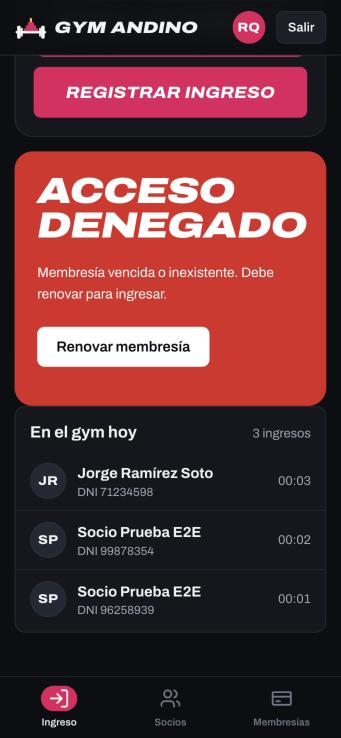
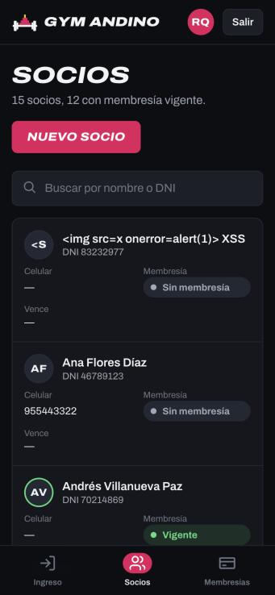

# Pruebas de Gym Andino

Evidencia de las pruebas ejecutadas sobre el sistema **en producción** (<https://gym-andino.onrender.com>) y en local, el 11 y 12 de noviembre de 2026.

## Resumen

| Nivel | Qué se probó | Dónde | Casos | Resultado |
|---|---|---|---|---|
| Unitarias e integración | API, reglas de negocio y seguridad (`npm test`) | Local y en cada despliegue de Render | 15 | ✅ 15 de 15 |
| Punta a punta (E2E) | Los 6 módulos contra la URL pública (`npm run e2e`) | Producción | 33 | ✅ 33 de 33 |
| Interfaz y responsive | Celular (375 px) y escritorio (1366 px) en el navegador | Producción | 7 | ✅ 7 de 7 |
| **Total** | | | **55** | **✅ 55 de 55 (100 %)** |

- Tiempo de respuesta promedio en producción: **139 ms** (máximo 299 ms) con el servicio despierto.
- Defectos encontrados durante el desarrollo: **8**, todos **corregidos y verificados** (ver [Registro de defectos](#registro-de-defectos)).

## Cómo volver a ejecutar las pruebas

```bash
npm test                                   # 15 pruebas unitarias y de integración (base en memoria)
npm run e2e                                # 33 pruebas E2E contra producción
node scripts/e2e.mjs http://localhost:3000 # las mismas pruebas E2E contra un servidor local
```

`npm run e2e` vuelve a generar [reporte-e2e.md](reporte-e2e.md) y [reporte-e2e.json](reporte-e2e.json). En local, el caso E2E-07 falla a propósito: la cookie `Secure` solo se activa en producción, porque allí la app se sirve por HTTPS.

## 1. Pruebas unitarias y de integración (15/15)

Archivo: [`test/api.test.js`](../../test/api.test.js). Salida de la ejecución: [resultado-npm-test.txt](resultado-npm-test.txt).

Render también las ejecuta en cada despliegue (`buildCommand: npm test` en [`render.yaml`](../../render.yaml)). Si alguna falla, la versión nueva no se publica.

| ID | Caso | Estado |
|---|---|---|
| CP-01 | Login correcto devuelve el usuario y la cookie de sesión | ✅ |
| CP-02 | Login con contraseña incorrecta devuelve 401 con mensaje genérico | ✅ |
| CP-03 | La cuenta se bloquea 1 minuto tras 5 intentos fallidos | ✅ |
| CP-04 | Sin sesión, la API protegida devuelve 401 | ✅ |
| CP-05 | Recepción no puede ver reportes ni crear planes (403) | ✅ |
| CP-06 | Validación de DNI, celular y correo del socio | ✅ |
| CP-07 | No se permite DNI duplicado (409) | ✅ |
| CP-08 | Fechas de la membresía y renovación encadenada | ✅ |
| CP-09 | Método de pago inválido devuelve 400 | ✅ |
| CP-10 | Ingreso con membresía vigente y no se repite el mismo día | ✅ |
| CP-11 | Ingreso rechazado por membresía vencida, sin membresía o DNI inexistente | ✅ |
| CP-12 | Anular membresía es solo del administrador y descuenta de los ingresos | ✅ |
| CP-13 | El reporte valida el rango de fechas | ✅ |
| CP-14 | Validación y unicidad de planes | ✅ |
| CP-15 | Archivos estáticos servidos y protección contra salida de directorio | ✅ |

## 2. Pruebas E2E en producción (33/33)

Script: [`scripts/e2e.mjs`](../../scripts/e2e.mjs). Reporte completo con resultado esperado, resultado obtenido y tiempo de cada caso: **[reporte-e2e.md](reporte-e2e.md)**.

| Módulo | Casos | Qué cubren |
|---|---|---|
| General | E2E-01, 02, 04 | Salud del servicio, cabeceras de seguridad (CSP, `nosniff`, `X-Frame-Options`), rutas inexistentes |
| M1 Autenticación y roles | E2E-05 a 13, 32 | Login, cookie `HttpOnly` + `Secure` + `SameSite=Strict`, bloqueo por intentos, permisos de recepción, cierre de sesión |
| M2 Socios | E2E-14 a 17 | Validaciones, registro, DNI duplicado, búsqueda |
| M3 Planes | E2E-30 | Validación de precio y duración |
| M4 Membresías | E2E-20 a 22, 31 | Método de pago, venta de 30 días, renovación sin cortes, anulación solo por administrador |
| M5 Ingreso | E2E-19, 23 a 27 | Sin membresía, vigente, doble ingreso, DNI inexistente o mal escrito, membresía vencida |
| M6 Reportes | E2E-28, 29 | Datos del reporte y validación del rango de fechas |
| Seguridad | E2E-03, 18 | Salida de directorio e inyección SQL |
| Rendimiento | E2E-33 | Tiempo promedio de respuesta menor a 1500 ms |

## 3. Pruebas de interfaz y responsive en producción (7/7)

Ejecutadas en el navegador sobre <https://gym-andino.onrender.com>, emulando un celular de 375 × 812 px y una pantalla de escritorio de 1366 × 820 px.

| ID | Caso | Resultado obtenido | Estado | Evidencia |
|---|---|---|---|---|
| UI-01 | Inicio de sesión en celular | Se ve completo, sin desplazamiento horizontal | ✅ | [captura](evidencias/UI-01-login-celular.jpg) |
| UI-02 | Kiosko con teclado táctil (escritorio) | DNI `48120974` escrito con el teclado en pantalla, pase verde "¡A entrenar, Valeria!" con 13 días restantes y alta en el feed en vivo | ✅ | [captura](evidencias/UI-02-kiosko-teclado-escritorio.jpg) |
| UI-03 | Pase de membresía por vencer (celular) | Pase amarillo "Pasa y renueva" con 1 día restante; ancho de página 375 px = pantalla, sin desborde | ✅ | [captura](evidencias/UI-03-pase-por-vencer-celular.jpg) |
| UI-04 | Acceso denegado (celular) | Pase rojo "Acceso denegado" con el botón "Renovar membresía" | ✅ | [captura](evidencias/UI-04-acceso-denegado-celular.jpg) |
| UI-05 | Intento de XSS en el nombre del socio | El nombre `` se muestra como texto; 0 elementos inyectados en la página | ✅ | [captura](evidencias/UI-05-xss-como-texto.jpg) |
| UI-06 | Reportes en escritorio | 4 indicadores, 39 barras en los dos gráficos, 2 tablas accesibles equivalentes, sin desborde | ✅ | [captura](evidencias/UI-06-reportes-escritorio.jpg) |
| UI-07 | Menú y rutas según el rol | Recepción ve 3 secciones y el administrador 5; si recepción abre `#/reportes`, la app la devuelve a Ingreso | ✅ | — |

<p>
  
  
  
</p>

## Registro de defectos

Defectos reales encontrados mientras se construía y probaba el sistema (11/11/2026). Todos se corrigieron y se volvieron a probar.

| ID | Severidad | Defecto | Cómo se detectó | Corrección | Verificado con |
|---|---|---|---|---|---|
| DEF-01 | Alta | El bloqueo por 5 intentos fallidos nunca se activaba: el contador se reiniciaba en cada intento | Prueba automática CP-03 | Se corrigió la lógica del contador en `server.js` | CP-03, E2E-10 |
| DEF-02 | Baja | La prueba CP-12 calculaba mal el monto esperado (defecto de la prueba, no del sistema) | Revisión del resultado de CP-12 | Se corrigió el cálculo esperado en el test | CP-12 |
| DEF-03 | Media | El pase de acceso mostraba el texto "nullnull" debajo de la barra de progreso | Prueba visual en el navegador | Se filtran los elementos vacíos antes de dibujar el pase (`app.js`) | UI-02, UI-03 |
| DEF-04 | Media | En celular el kiosko se salía por la derecha (contador y pase cortados) | Prueba responsive a 375 px | Columnas de la grilla con `minmax(0, 1fr)` | UI-03 |
| DEF-05 | Baja | En celular la palabra "RENUEVA" se partía a mitad | Prueba responsive a 375 px | Avatar arriba del veredicto y corte solo cuando la palabra no cabe | UI-03 |
| DEF-06 | Baja | Primera versión del diseño: el menú lateral de escritorio estiraba los enlaces a lo alto | Prueba visual en escritorio | Filas del menú con alto según su contenido | UI-06 |
| DEF-07 | Baja | Primera versión del diseño: el nombre de la marca se partía en dos líneas en el encabezado de celular | Prueba responsive | Marca sin salto de línea y nombre de usuario recortado | UI-01 |
| DEF-08 | Media | Las fuentes de Google no cargaban porque la política CSP las bloqueaba | Consola del navegador | Se permitió `fonts.googleapis.com` y `fonts.gstatic.com` en la CSP | E2E-02, UI-01 |

### Observaciones (no son defectos)

| ID | Observación |
|---|---|
| OBS-01 | En producción, los ataques de salida de directorio (E2E-03) e inyección SQL (E2E-18) los bloquea **Cloudflare**, que Render pone delante de la app, con 400 y 403, antes de llegar al servidor. La protección propia de la app (rutas normalizadas y consultas SQL parametrizadas) se verifica en local con CP-15 y con `node scripts/e2e.mjs http://localhost:3000`, donde E2E-18 devuelve 200 con 0 resultados. |
| OBS-02 | Plan gratuito de Render: el servicio se duerme tras 15 minutos sin uso (la primera visita tarda unos segundos) y la base vuelve a los datos de ejemplo en cada reinicio o despliegue. |
| OBS-03 | Las pruebas E2E crean en producción un socio de prueba ("Socio Prueba E2E") con un DNI aleatorio. Se borra solo cuando Render reinicia el servicio. |
